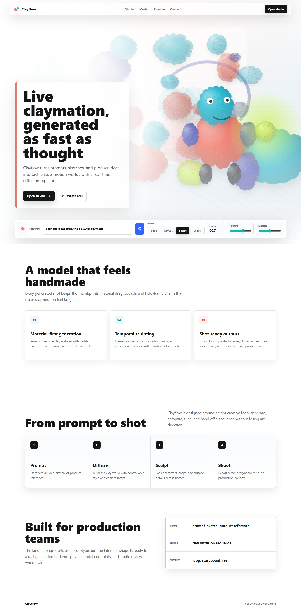

# Clayflow Landing Page

A concept landing page for **Clayflow**, a made-up "live claymation diffusion" product. Clayflow isn't a real product or company. This is a design and front-end exercise.



## Highlights

- **Procedurally animated "claymation" hero.** A `<canvas>` draws a lumpy clay character and props with grain, wobble and stepped, held-frame motion that looks like stop-motion.
- **The hero controls work:**
  - Typing a new prompt re-seeds the scene: the prompt text is hashed into a new palette and blob layout.
  - The Seed / Diffuse / Sculpt / Shoot stage buttons change how "finished" the render looks.
  - The Texture and Motion sliders adjust surface grain and movement.
- Respects `prefers-reduced-motion`, and the layout adapts to mobile (see [mobile screenshot](.design/clayflow-live-render-mobile.png)).
- Plain HTML, CSS and JavaScript with no frameworks, dependencies or build step.

## Running it

Open `index.html` in a browser. To serve it locally instead:

```bash
python -m http.server
# then visit http://localhost:8000
```

## Files

- `index.html`: page markup
- `styles.css`: layout and visual design
- `script.js`: canvas renderer and hero controls
- `.design/`: screenshots
